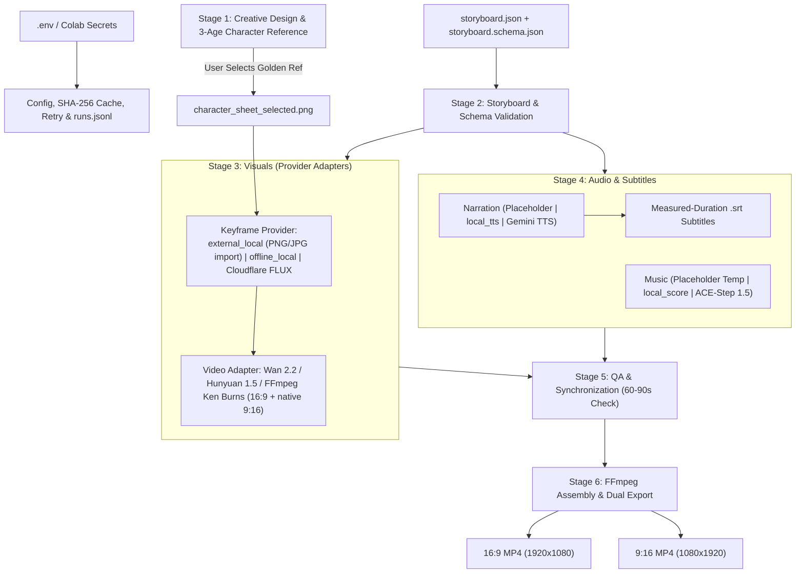

# System Architecture — A Brighter Tomorrow

## 1. Six-Stage Pipeline Overview



## 2. Stage Contracts & Caching

1. **Single Source of Truth:** `storyboard.json` validated against `storyboard.schema.json` (`8–12` shots, plus separate `end_card`, total duration `60.0–90.0s`).
2. **Stage Manifests (`outputs/manifests/`):** Each stage writes a manifest (`reference_manifest.json`, `storyboard_manifest.json`, `keyframes_manifest.json`, `video_manifest.json`, `audio_manifest.json`, `qa_report.json`) mapping each `shot_id` to its `cache_key` (SHA-256 of prompt, model, seed, reference hash, dimensions—or exact source file `sha256` for `external_local`) and file hash.
3. **External Image Import & Validation (`pipeline/providers/external_images.py`):** Supports `.png`, `.jpg`, `.jpeg`, and `.webp` files in `outputs/keyframes/` (detecting real image format via Pillow even if JPEG or WEBP bytes use a `.png` extension), rejects missing/corrupted/duplicate shots, preserves original files untouched, and logs honest provenance (`provider="external_manual"`, `seed=None`, `estimated_cost_usd=0.0`).
4. **Adaptive Stage 6 Subtitle & End-Card Rendering (`pipeline/stage6_assemble.py`):** Renders calibrated `libass` subtitle styles separately for `16:9` (`FontSize=14,MarginV=20`) and `9:16` (`FontSize=6,MarginV=24` to compensate for `libass` `PlayResY=288` vertical scaling) and passes explicit Windows font paths to FFmpeg `drawtext` for the 3.0s AI disclosure end card.
5. **Selective Regeneration:** Editing one shot's narration or replacing one external keyframe changes only that shot's `cache_key`. Re-running skips unchanged shots (`cache_hit: true` in `logs/runs.jsonl`).
6. **Safety Lock (`ALLOW_PAID_API=false`):** Prevents accidental external API spending until explicitly enabled (`ALLOW_PAID_API=true` or `--confirm-api`).

## 3. Retry & Failure Handling Policy

* **Transient HTTP Errors (`408`, `429`, `500`, `502`, `503`, `504`):** Exponential backoff with jitter (`pipeline/retry.py`).
* **Auth / Bad Request Errors (`400`, `401`, `403`, `404`, `422`):** Fail fast without retrying to avoid burning quota.
* **Honest Fallbacks:** GPU video models (`Wan 2.2 TI2V-5B`, `HunyuanVideo-1.5`) are never assumed to fit on a 15 GB Colab T4 without smoke testing. If GPU clips are missing and `--allow-ken-burns-fallback` is passed, `pipeline/providers/video_adapter.py` generates deterministic FFmpeg `zoompan` clips and explicitly logs `is_fallback: true`.

---

## 4. Credential Verification Guide (Windows PowerShell & Colab/Linux)

Never paste real credentials into files, commands saved in git, or logs.

### A. Google Gemini API (`GEMINI_API_KEY`)
* **Create key:** [https://aistudio.google.com/apikey](https://aistudio.google.com/apikey)
* **Docs:** [https://ai.google.dev/gemini-api/docs/api-key](https://ai.google.dev/gemini-api/docs/api-key) | [Speech Generation](https://ai.google.dev/gemini-api/docs/speech-generation)

**Windows PowerShell:**
```powershell
$env:GEMINI_API_KEY = "paste_your_key_here"
Invoke-RestMethod -Uri "https://generativelanguage.googleapis.com/v1beta/models?key=$env:GEMINI_API_KEY" | Select-Object -ExpandProperty models | Select-Object -First 5 name
```

**Google Colab / Linux Bash:**
```bash
export GEMINI_API_KEY="paste_your_key_here"
curl -sS "https://generativelanguage.googleapis.com/v1beta/models?key=${GEMINI_API_KEY}" | head -n 20
```

### B. Cloudflare Workers AI (`CLOUDFLARE_API_TOKEN`, `CLOUDFLARE_ACCOUNT_ID`)
* **Create account & token:** [https://dash.cloudflare.com](https://dash.cloudflare.com) → **My Profile** → **API Tokens** → **Create Token** → **Workers AI** template (**Account → Workers AI → Read & Edit**).
* **Important Endpoint Distinction:**
  * **User-owned API token** (created under *My Profile → API Tokens*): verify with `GET https://api.cloudflare.com/client/v4/user/tokens/verify`
  * **Account-owned API token** (created under *Manage Account → Account API Tokens*): verify with `GET https://api.cloudflare.com/client/v4/accounts/{ACCOUNT_ID}/tokens/verify`
  * Mismatching the token type and verification endpoint returns `401 Unauthorized`.

**Windows PowerShell (User API Token):**
```powershell
$env:CLOUDFLARE_API_TOKEN = "paste_your_token_here"
Invoke-RestMethod -Uri "https://api.cloudflare.com/client/v4/user/tokens/verify" -Headers @{ Authorization = "Bearer $env:CLOUDFLARE_API_TOKEN" }
```

**Windows PowerShell (Account-Owned API Token):**
```powershell
$env:CLOUDFLARE_ACCOUNT_ID = "paste_your_account_id_here"
$env:CLOUDFLARE_API_TOKEN = "paste_your_token_here"
Invoke-RestMethod -Uri "https://api.cloudflare.com/client/v4/accounts/$env:CLOUDFLARE_ACCOUNT_ID/tokens/verify" -Headers @{ Authorization = "Bearer $env:CLOUDFLARE_API_TOKEN" }
```

**Google Colab / Linux Bash (User API Token):**
```bash
export CLOUDFLARE_API_TOKEN="paste_your_token_here"
curl -sS -X GET "https://api.cloudflare.com/client/v4/user/tokens/verify" \
  -H "Authorization: Bearer ${CLOUDFLARE_API_TOKEN}"
```

**Google Colab / Linux Bash (Account-Owned API Token):**
```bash
export CLOUDFLARE_ACCOUNT_ID="paste_your_account_id_here"
export CLOUDFLARE_API_TOKEN="paste_your_token_here"
curl -sS -X GET "https://api.cloudflare.com/client/v4/accounts/${CLOUDFLARE_ACCOUNT_ID}/tokens/verify" \
  -H "Authorization: Bearer ${CLOUDFLARE_API_TOKEN}"
```

### C. Hugging Face Hub (`HF_TOKEN`)
* **Create read token:** [https://huggingface.co/settings/tokens](https://huggingface.co/settings/tokens) (**Read** role)
* **Docs:** [https://huggingface.co/docs/hub/security-tokens](https://huggingface.co/docs/hub/security-tokens)

**Windows PowerShell:**
```powershell
$env:HF_TOKEN = "paste_your_hf_token_here"
Invoke-RestMethod -Uri "https://huggingface.co/api/whoami-v2" -Headers @{ Authorization = "Bearer $env:HF_TOKEN" }
```

**Google Colab / Linux Bash:**
```bash
export HF_TOKEN="paste_your_hf_token_here"
curl -sS -H "Authorization: Bearer ${HF_TOKEN}" https://huggingface.co/api/whoami-v2
```
